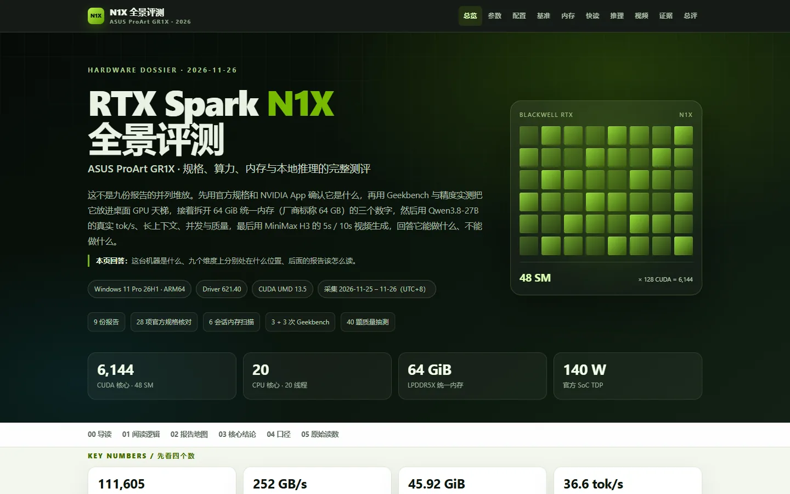

# N1X RTX Spark 全景评测站

ASUS ProArt GR1X（NVIDIA RTX Spark N1X）的静态评测站：9 份报告 + 1 个总览页，纯 HTML / CSS / JS；10 个手写页面无外部字体、CDN 或追踪脚本，官方规格归档页已禁用脚本，支持 `file://` 直接打开和离线打包。



## 内容结构

| 编号 | 页面 | 内容 |
|---|---|---|
| 00 | `index.html` | 总览：三条阅读路径、报告地图、核心结论、口径与原始读数 |
| 01 | `spec.html` | 参数与能力报告：官方三档、28 项逐条核对、编解码实测 |
| 02 | `nvidia-app.html` | NVIDIA App 图文配置：18 张截图、9 个应用页面 |
| 03 | `benchmark.html` | GPU 性能基准：Geekbench 7、各精度 GEMM、带宽 |
| 04 | `memory.html` | 内存与带宽实测：三个口径、跨边界扫描、页放置、超配 |
| 05 | `memory-story.html` | 快读长文《同一个 GB10，两种内存命运》 |
| 06 | `qwen.html` | Qwen3.8-27B IQ4_XS 本地推理：短/长上下文、MTP、并发、质量 |
| 07 | `h3.html` | MiniMax H3 视频生成：5s / 10s、原生 ComfyUI vs FreeVideo |
| 08 | `evidence.html` | 证据墙：nvidia-smi、官方规格归档、原始日志与数字字典 |
| 09 | `verdict.html` | 总评与选型：适合谁、哪些待补测、内存与并发规划 |

阅读顺序不是线性的：主线是「身份 → 算力 → 内存 → LLM → 视频 → 结论」，02 / 05 / 08 分别是配置旁证、快读与证据索引。首页提供 10 分钟 / 1 小时 / 半天三条路径。

## 设计

- 主色 `#76b900`，深色底 `#08110a`，纸白 `#f3f6ef`
- `assets/site.css`：全站设计系统；`assets/site.js`：移动导航、TOC 高亮、阅读进度、图片灯箱
- `assets/frame.css`：只用于 `spec.html`，给原始参数报告套站点头部与返回条
- 图片统一 WebP（UI 截图 q85、图表 q82），保持原分辨率；PNG 源不随仓库发布
- `` 均带 `width` / `height` 预留版面，首屏外 `loading="lazy"`，打印前由脚本转 eager
- 双列缩略图用 `srcset` 提供 2× 版本（1058px），灯箱通过 `data-full` 仍打开原图
- `spec.html` 不内嵌 base64，5 张截图外链到 `assets/img/spec/`，与证据页共享缓存
- 首访字节：10 页合计约 0.8 MB（优化前 15.1 MB）；`h3` 单页约 137 KB（原 7.15 MB）
- `_headers`：Cloudflare Pages / Netlify 的缓存策略（HTML no-cache、assets 30 天），GitHub Pages 忽略
- 灯箱在桌面与移动端均可拖动查看
- 10 个手写页内置最小 CSP：`script-src 'self'`，禁止外部连接、框架、表单与对象
- `assets/spec/*.html` 归档页内置 `script-src 'none'`：不执行 NVIDIA / 供应商脚本、不写 Cookie，样式从简
- 原始日志（101 个文件）与含本机标识的 JSON 不随仓库发布

## 目录结构

```text
n1x-site-2026-11-26/
├─ index.html                 # 总览
├─ spec.html                  # 01 参数与能力（含原报告样式）
├─ nvidia-app.html            # 02 NVIDIA App
├─ benchmark.html             # 03 GPU 基准
├─ memory.html                # 04 内存与带宽
├─ memory-story.html          # 05 快读
├─ qwen.html                  # 06 Qwen 推理
├─ h3.html                    # 07 MiniMax H3 视频
├─ evidence.html              # 08 证据墙
├─ verdict.html               # 09 总评
├─ assets/
│  ├─ site.css / site.js / frame.css / favicon.svg
│  ├─ img/
│  │  ├─ nvidia-smi.webp
│  │  ├─ fig-bandwidth-scan.webp
│  │  ├─ bench/               # Geekbench / 精度 / 带宽图
│  │  ├─ h3/                  # H3 工作流、遥测、抽帧（14 张）
│  │  ├─ nvapp/               # NVIDIA App 18 张截图
│  │  ├─ qwen/                # Qwen 解码 / 缓存 / 并发 / 热稳态图
│  │  ├─ readme/              # README 用的首页截图
│  │  └─ spec/                # 参数报告的编解码与规格截图
│  ├─ downloads/              # 4 份 PDF 报告（按需下载）
│  └─ spec/                   # NVIDIA 官方规格页 / 编解码矩阵归档
├─ tools/
│  ├─ check_links.py          # 本地链接与锚点全量校验
│  ├─ qa.py                   # Playwright 三视口验收
│  ├─ offline_pack.py         # 生成离线 ZIP（白名单：10 页 + assets/ + NOTICE）
│  └─ build_spec.py           # 参数报告外壳（已加防覆盖保护）
├─ .github/workflows/pages.yml # Actions 白名单发布（不含 tools/）
├─ .gitignore
├─ NOTICE                     # 版权与第三方素材说明
├─ LICENSE                    # 代码 MIT
├─ LICENSE-CONTENT            # 原创文字/表格/图表 CC BY 4.0
├─ _headers                   # 静态托管缓存头（Cloudflare / Netlify）
├─ .nojekyll                  # Pages 不走 Jekyll
└─ README.md
```

`tools/qa/`、`tools/tmp/`、`tools/perf-tmp/` 是验收临时目录，已被 `.gitignore` 排除，不随仓库分发。

## 本地查看

不需要安装依赖，也没有构建步骤：

1. **直接打开**：双击 `index.html`，或拖进 Chrome / Edge / Firefox。所有路径都是相对路径，断网可用。
2. **本地 HTTP**（推荐用于打印或某些浏览器限制）：

```bash
cd n1x-site-2026-11-26
python -m http.server 8000 --bind 127.0.0.1
# 打开 http://127.0.0.1:8000/
```

## 部署

这是一个纯静态站点，任何静态托管都可以。本仓库用 GitHub Actions 组装 `_site`（只含站点文件）后发布；Cloudflare Pages / Netlify 则直接把仓库根目录作为发布目录。

### GitHub Pages（推荐：Actions 白名单）

仓库提供 `.github/workflows/pages.yml`：推送 `main` 后只发布 10 个 HTML、`assets/`、`_headers` 和 `.nojekyll`；`tools/`、`README.md`、`.github/` 留在仓库但不出现在网站 URL 下。先确认该文件已提交到 `main`（当前它仍是未跟踪文件；提交需要 token 具备 `workflow` 权限）。

```text
Settings → Pages → Build and deployment
  Source: GitHub Actions
```

在 **Actions** 里确认 “Deploy site to GitHub Pages” 成功，地址为 `https://<用户名>.github.io/rtx-spark-n1x-website/`。

若改成 “Deploy from a branch” + `main / (root)`，会把 `tools/` 和 README 也作为网站文件公开。

注意：当前仓库是 **private**。GitHub Pages 对私有仓库需要 GitHub Pro / Team 及以上；免费账号请先把仓库改为 public，或改用 Cloudflare Pages / Netlify。

仓库改为 public 后，免费账号的限制与本站现状：

| 项目 | GitHub 限制 | 本站现状 |
| --- | --- | --- |
| 仓库可见性 | 公开仓库：源码、截图、PDF 全部可被查看与克隆 | 102 个文件 / 9.6 MB，无密钥、无 token、无原始日志 |
| 发布站点体积 | ≤ 1 GB | 9.6 MB，约占上限 1% |
| 月流量 | 100 GB 软限制 | 纯静态页 + 本地图片，个人分享远达不到 |
| 构建频率 | 10 次/小时软限制 | Actions 每次推送发布一次 |
| 服务端能力 | 仅静态文件，不支持后端 / SSR | 不需要 |

改为 public 前建议确认三件事：

1. **原始日志已移除**：`assets/logs/`（101 个文件）已从当前树和远端**可达历史**移除（历史已重写为不含日志的干净提交）；GitHub 端可能仍缓存不可达对象，若需彻底清理请联系 GitHub Support。含主机名、Windows 用户目录路径和 GPU UUID 的文件只保留在仓库外的本地备份中。
2. **公开基本不可撤回**：页面与文件可被搜索引擎收录、被 fork 或缓存；即使之后删库或改回 private，副本仍可能留在他人手里。
3. **用途限制**：GitHub Pages 不允许用于纯商业交易类站点；个人评测、技术分享没问题。

操作：Settings → General → 最下方 Danger Zone → Change visibility → Make public；再到 Settings → Pages 选 **Source: GitHub Actions**（先提交 `.github/workflows/pages.yml`，见上），约 1 分钟后 `https://mir-of.github.io/rtx-spark-n1x-website/` 生效。之后每次 `git push` 自动重新发布。

### Cloudflare Pages / Netlify / Vercel

- Framework preset：None
- Build command：留空
- Output / Publish directory：`/`（仓库根目录）
- 无需环境变量

### Nginx

```nginx
server {
    listen 80;
    server_name example.com;
    root /var/www/n1x-site-2026-11-26;
    index index.html;

    location / {
        try_files $uri $uri/ =404;
    }

    # 静态资源长缓存；HTML 不缓存，便于更新后立即生效
    location ~* \.(css|js|png|jpg|jpeg|svg|pdf|json|txt)$ {
        expires 30d;
        add_header Cache-Control "public, immutable";
    }
    location ~* \.html$ {
        add_header Cache-Control "no-cache";
    }
}
```

### 离线分享包

```bash
python tools/offline_pack.py
```

会在站点上一级生成 `N1X-RTX-Spark-评测网站-离线版-<日期>.zip`。打包采用显式白名单：只含 10 个根目录 HTML、`assets/` 整目录和 `NOTICE` / `LICENSE` / `LICENSE-CONTENT`，并注入 `使用说明.txt`；`README.md`、`_headers`、`.gitignore`、`.nojekyll`、`tools/`、`.github/`、任何 `*.zip` 与 `assets/logs/` 都不会进入压缩包。解压后双击 `index.html` 即可。

## 维护

```bash
# 链接与锚点检查（会扫描根目录所有 *.html）
python tools/check_links.py

# 三视口验收：需要 Playwright 与 Edge
# Windows 下把 TEMP/TMP 指到可写目录，避免 mkdtemp EPERM
python tools/qa.py
```

- `spec.html` 由 `tools/build_spec.py` 生成过一次，之后包含手工修订（口径、64 GiB、role-pill 等）。脚本现在默认**拒绝覆盖**；确需重建时用 `--force`，然后必须重新应用这些修订。
- 新增报告时不只是加一个 HTML：还要同步 10 个页面的 topbar / 页脚、首页报告地图与阅读链、`page-nav` 的上一份/下一份、以及正文里的「0X 报告」引用。编号顺延后跑一遍 `check_links.py` 与 `qa.py`。

## 数据与口径

- 容量默认 GiB，带宽默认 GB/s；厂商标称的 64 GB 在正文中写作「64 GiB（标称 64 GB）」。
- 三个内存口径分开：NVML 专用 FB（30.5 GiB）、CUDA 可分配配额（45.92 GiB）、Windows 可见（32.18 GiB）。
- 所有关键数字标注「官方 / 实测 / 推算」；`evidence.html` 有数字字典与证据等级。
- 原始日志不随仓库发布，保留在作者本地；正文引用的读数可在 `evidence.html` 的证据截图与数字字典中核对。

## 许可

- 代码（HTML / CSS / JS 与 `tools/` 下的 Python 脚本）：MIT，见 `LICENSE`
- 原创文字、表格与图表：CC BY 4.0，见 `LICENSE-CONTENT`；转载需注明出处并链接回本站
- 第三方素材（NVIDIA 归档页 / PDF / 截图 / 商标）不在上述授权内，见 `NOTICE`

## 声明

本站是个人评测汇总，不构成 NVIDIA / ASUS / 阿里云 / MiniMax 官方认证。测试结果仅代表本机在 2026-11-25 至 11-26 的配置与软件栈；官方规格可能随页面更新而变化，以归档文件与原始链接为准。所有商标归各自所有者。
